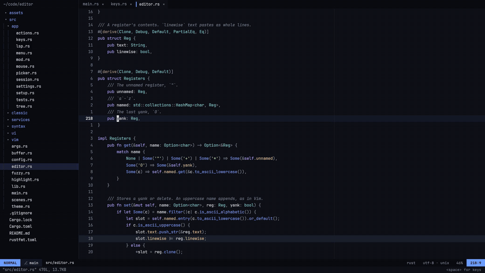
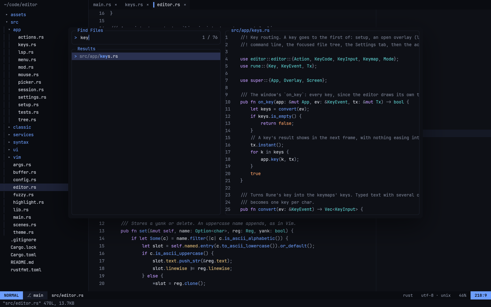
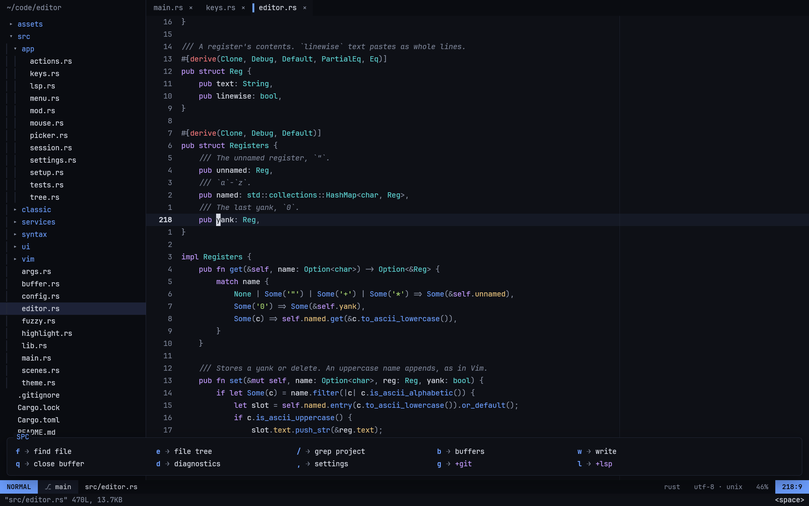
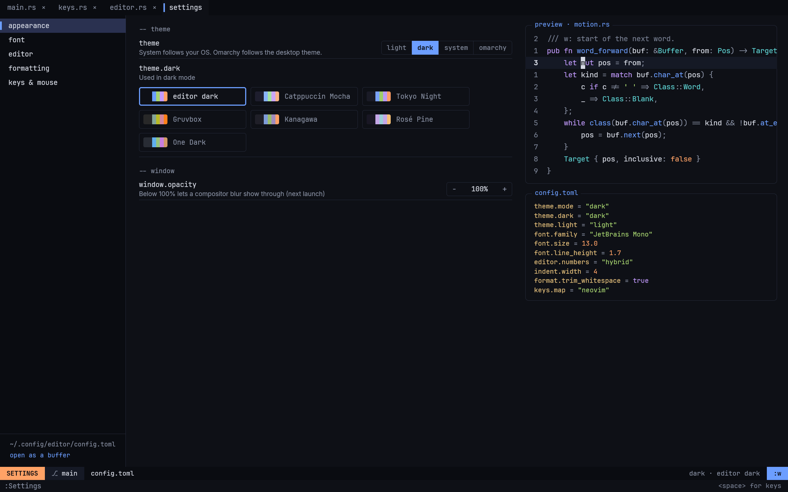
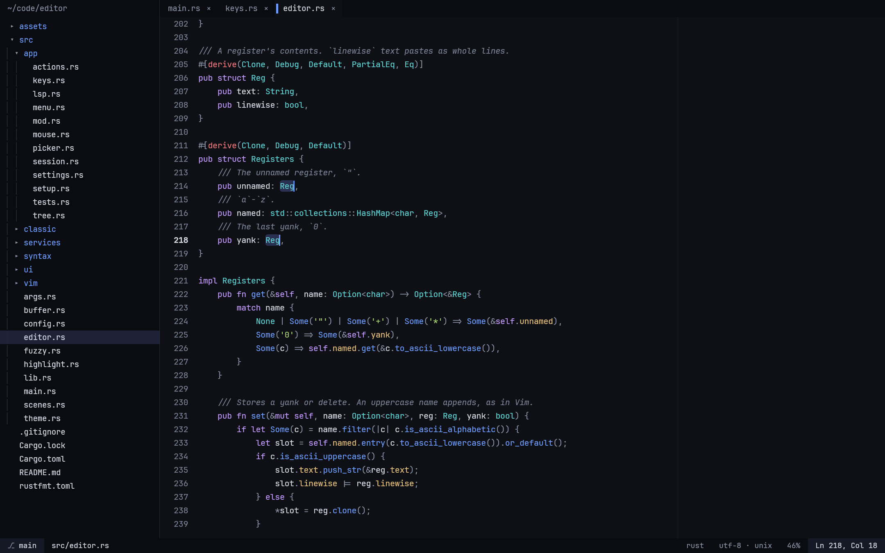
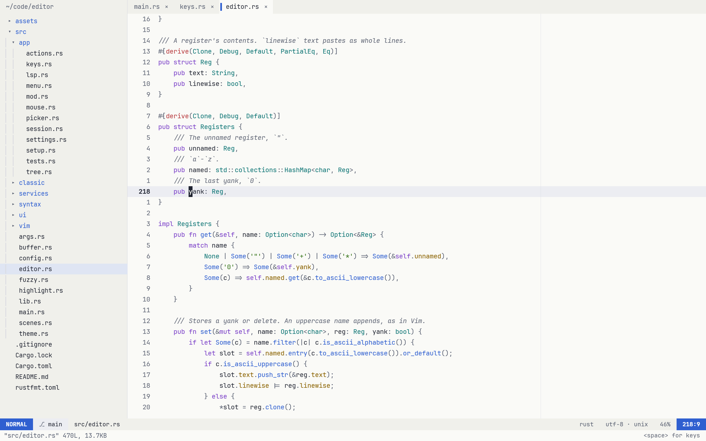
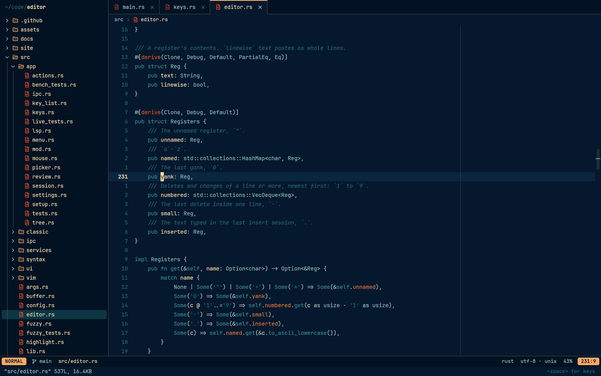
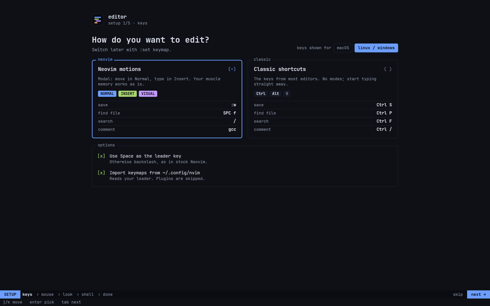
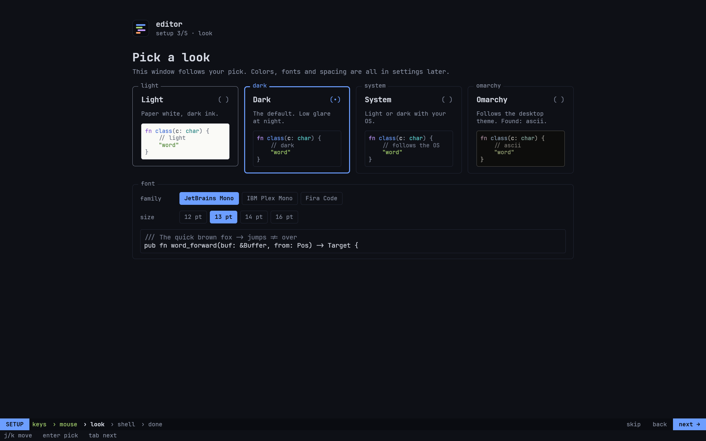

<div align="center">


# editor

**Read fast. Edit quick.**

A modal code editor in Rust, built on [Rune](https://github.com/anomalyco/rune). It opens
before you finish the thought, it keeps your Neovim muscle memory, and it stays out of the way.

[Website](https://bjarneo.github.io/editor/) · [Install](#install) · [Keys](docs/keymaps.md) ·
[Command line](docs/cli.md) · [Configuration](docs/configuration.md) ·
[AI agents](docs/agents.md) · [How it works](docs/architecture.md) ·
[Performance](docs/performance.md) ·
[Promo video](docs/media/editor-promo.mp4)



</div>

## What it is

editor is for opening code, reading it, finding your way around it and making quick edits.
It is not an IDE, and it is not for writing all day. Every feature earns its place against
that, and against speed.

- **Real Vim, or classic keys.** Counts, operators, text objects, dot repeat, registers,
  macros, marks and Visual block. Or no modes at all, with multiple cursors. Pick one at first
  launch and switch any time.
- **Code-aware.** Tree-sitter text objects (`af`, `ic`, `ia`) and motions (`]f`, `[c`) in 13
  languages. LSP with diagnostics, go to definition, references, hover, completion, rename and
  code actions, from whatever servers you have installed.
- **Find anything.** A fuzzy file finder, project search through ripgrep, a file tree with git
  status, and a list of every key with search: `F1`.
- **Works with your AI agent.** No AI inside. Instead, Claude Code, Codex or any CLI agent sees
  what you are looking at and drives the editor over `editor mcp` or `editor ctl`: it reads
  your selection and unsaved text, points you at code, and proposes changes you accept with `y`.
- **Safe.** Crash recovery, undo that survives a restart, a clean reload with changed lines
  marked when a git checkout or an agent changes a file under you, and atomic saves.
- **Yours.** 16 themes, or follow your [Omarchy](https://omarchy.org) desktop theme live. Any
  monospace font. Settings is a buffer that writes `config.toml`.

<table>
<tr>
<td></td>
<td></td>
</tr>
<tr>
<td></td>
<td></td>
</tr>
<tr>
<td></td>
<td></td>
</tr>
</table>

## Install

### Release binaries

Download the archive for your system from the
[latest release](https://github.com/bjarneo/editor/releases/latest). Each archive holds one
folder with `editor`, the README, the license and the icon.

| Archive | System |
| --- | --- |
| `editor-v<version>-x86_64-linux.tar.gz` | Linux, x86-64 |
| `editor-v<version>-aarch64-linux.tar.gz` | Linux, ARM64 |
| `editor-v<version>-aarch64-macos.tar.gz` | macOS, Apple silicon |
| `editor-v<version>-x86_64-macos.tar.gz` | macOS, Intel |

On Linux, put `editor` on your `PATH`:

```sh
tar -xzf editor-v*-x86_64-linux.tar.gz
install -Dm755 editor-v*/editor ~/.local/bin/editor
editor .
```

The Linux archive also holds `editor.desktop`, for app launchers. Setup can install it and
make editor the default app for text files.

The macOS binaries are not signed. Remove the quarantine flag before the first run:

```sh
tar -xzf editor-v*-aarch64-macos.tar.gz
xattr -d com.apple.quarantine editor-v*/editor
mkdir -p ~/.local/bin && cp editor-v*/editor ~/.local/bin/
~/.local/bin/editor .
```

macOS does not put `~/.local/bin` on your `PATH`. Setup's terminal step adds it to your shell
startup file.

### With Cargo

```sh
cargo install --locked --git https://github.com/bjarneo/editor
```

Linux needs the Wayland and xkbcommon development packages to build:

```sh
sudo apt-get install pkg-config libxkbcommon-dev libwayland-dev    # Debian, Ubuntu
sudo pacman -S pkgconf libxkbcommon wayland                        # Arch
sudo dnf install pkgconf-pkg-config libxkbcommon-devel wayland-devel   # Fedora
```

## Quick start

```sh
editor .                 # this folder as the project
editor src/main.rs:42    # a file, at line 42
editor +42 src/main.rs   # the same
```

A file opens in its project: the git work tree around it, else the nearest folder with a
`Cargo.toml`, `package.json`, `go.mod` or a similar file. With no arguments, editor opens the
current folder and restores its last session.

The first launch runs a five-step setup: keys, mouse, look, terminal and ready. The terminal
step can add an `editor` command, set `$EDITOR` and set git's editor. On Linux, it can also
make editor the default app for text files. It shows every command before it runs, and it
runs only the ones you leave on.

<table>
<tr>
<td></td>
<td></td>
</tr>
</table>

## Keys

| Action | Neovim | Classic |
| --- | --- | --- |
| Save | `:w` | `Ctrl S` |
| Go to file | `SPC f` | `Ctrl P` |
| Find in project | `SPC /` | `Ctrl ⇧ F` |
| Command line | `:` | |
| Command palette | | `Ctrl ⇧ P` |
| Every key, with search | `SPC ?`, `F1` | `F1` |
| Leader keys, in a popup | `SPC` | |
| Go to definition | `gd` | `F12` |
| Rename symbol | `SPC l n` | `F2` |
| Code actions | `SPC l a` | `Ctrl .` |
| Select a function | `vaf` | |
| Next function | `]f` | |
| Toggle comment | `gcc` | `Ctrl /` |
| Add a cursor at the next match | | `Ctrl D` |
| Focus the file tree | `SPC e` | `Ctrl ⇧ E` |
| Show or hide the file tree | `:Tree` | `Ctrl B` |
| Settings | `:Settings` | `Ctrl ,` |

On macOS, `⌘` replaces `Ctrl` in the classic keymap. [docs/keymaps.md](docs/keymaps.md) has
every key.

## Configuration

Settings is a tab. Open it with `:Settings` or `SPC ,` in the Neovim keymap, or with `Ctrl ,`
in the classic keymap. Change options, and `:w` writes `~/.config/editor/config.toml`. Every
change applies at once.

```toml
[theme]
mode = "omarchy"     # light, dark, system or omarchy
dark = "tokyo-night"

[font]
family = "JetBrains Mono"
size = 13.0

[keys]
map = "neovim"       # or "classic"
```

A project's `.editorconfig` sets indentation, line endings and save rules for each file.
[docs/configuration.md](docs/configuration.md) lists every option.

## Language servers

editor starts the server for a file when one is installed: `rust-analyzer`, `gopls`,
`pyright-langserver`, `typescript-language-server`, `clangd`, `lua-language-server` or `zls`.
Servers run on their own thread, so they never block typing. See [docs/lsp.md](docs/lsp.md).

## AI agents

```sh
claude mcp add editor -- editor mcp          # Claude Code: the editor as tools
editor ctl state                             # any agent or script: what you are looking at
editor ctl reveal src/main.rs:10-14 --note "this is the bug"
sed 's/foo/bar/' src/main.rs | editor ctl propose src/main.rs --label "rename foo"
```

The agent reads the active file, selection, unsaved buffers and LSP diagnostics, points you at
lines, and proposes changes that open as a diff: `y` accepts, `n` rejects. Changes it writes to
disk reload with their lines marked, and `SPC a l` lists them. `editor --wait` makes editor a
good `$EDITOR` for agents and git. [docs/agents.md](docs/agents.md) has setup for Claude Code,
Codex and opencode, and the protocol.

## How it works

The editing core is a library with no window code: the buffer, modes, both keymaps and
tree-sitter. The app draws it with Rune and keeps every slow job on a worker thread: files,
the project index, git, ripgrep, the file watcher and the language servers. No file I/O runs
on the UI thread while you edit. [docs/architecture.md](docs/architecture.md) walks through it.

## Performance

Measured on a release build, Linux, x86-64:

| Target | Result |
| --- | --- |
| Open a 100 MB file in under 1 s | 175 ms |
| Keystroke to frame in under 8 ms | 0.3 ms median, 1.4 ms at the 95th percentile |
| An idle window draws nothing | It draws one frame per key, then rests |

[docs/performance.md](docs/performance.md) has the method and the numbers.

## Develop

```sh
cargo build
cargo test                                            # core, tree-sitter, app and IPC tests
target/debug/editor --snap out.png --scene finder     # render a scene, no window
```

[docs/development.md](docs/development.md) covers the layout of the code, the tests, scenes,
recording videos and making a release.

## Not built yet

- Highlighting uses Rune's lexers. Tree-sitter drives only code objects and motions.
- `gr`, `gF`, and `gn` that extends an existing Visual selection.
- With several cursors, auto-closing brackets types only the char. `Tab` replaces each
  selection instead of indenting its lines, and `⇧ Tab` keeps only the main cursor.

## License

[MIT](LICENSE).
